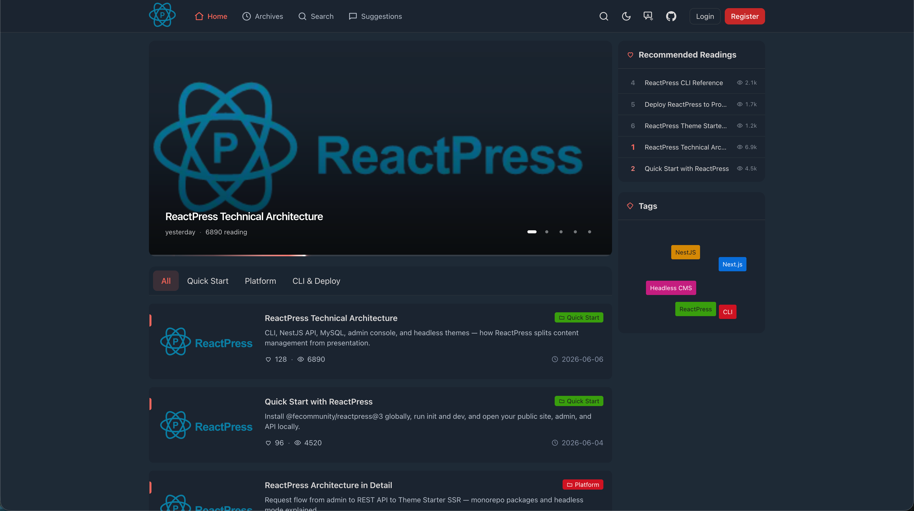
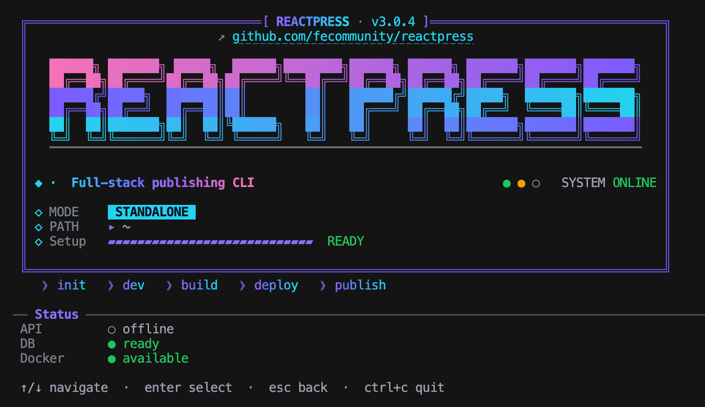
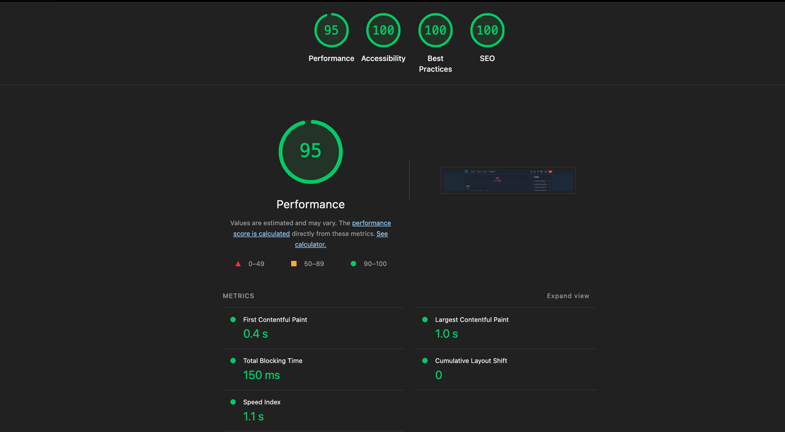

# ReactPress Theme Starter

<div align="center">

<a href="https://reactpress.cc/">
  
</a>

<br />

**Ship the public site. Leave the CMS to ReactPress.**

<br />

Official Next.js theme for [ReactPress](https://github.com/reactpressjs/reactpress) —
routing, layout, SEO, and UI. Content comes from the headless API; no CMS bundled here.

<br />

<a href="https://reactpress-theme-starter.vercel.app">
  
</a>

<br />

[Docs](https://reactpress.cc/) ·
[Live Demo](https://reactpress-theme-starter.vercel.app) ·
[ReactPress](https://github.com/reactpressjs/reactpress) ·
[简体中文](./README_zh.md)

<br />


<a href="https://github.com/reactpressjs/reactpress-theme-starter/stargazers">
  
</a>

</div>

---

## Why this theme

A production-ready visitor frontend for the ReactPress stack — not another bare Next.js blog scaffold.

|                          | What you get                                                                  |
| :----------------------- | :---------------------------------------------------------------------------- |
| **Headless by design**   | REST via [`@fecommunity/reactpress-toolkit`](https://www.npmjs.com/package/@fecommunity/reactpress-toolkit) — content stays in ReactPress |
| **Try without backend**  | `pnpm dev:mock` — full UI with sample data, same as the [live demo](https://reactpress-theme-starter.vercel.app) |
| **Built-in surfaces**    | Articles, archives, search, CMS pages, knowledge base, comments, light/dark, RSS & sitemap |
| **Admin-driven look**    | Appearance (colors, logo, nav) from the ReactPress console + [`theme.json`](./theme.json) |
| **Performance**          | Lighthouse **95 / 100 / 100 / 100** out of the box (see below)                |

```text
ReactPress API  ──REST──▶  Theme Starter (Next.js)  ──▶  Public Site
```

**Stack:** Next.js 15 · React 19 · Tailwind CSS 4 · Node.js 22.23+ · pnpm 9

---

## Try in 60 seconds

No ReactPress install required — preview the theme with built-in mock data.

### Option A — `create-next-app` (recommended)

```bash
npx create-next-app@latest reactpress-theme-starter \
  --example "https://github.com/reactpressjs/reactpress-theme-starter" \
  --use-pnpm
cd reactpress-theme-starter
pnpm dev:mock
```

### Option B — clone

```bash
git clone https://github.com/reactpressjs/reactpress-theme-starter.git
cd reactpress-theme-starter
pnpm install
pnpm dev:mock
```

Open **http://localhost:3001**.

### Deploy to Vercel (zero env vars)

[`vercel.json`](./vercel.json) builds with mock data — one click, no backend.

[](https://vercel.com/new/clone?repository-url=https%3A%2F%2Fgithub.com%2Freactpressjs%2Freactpress-theme-starter&project-name=reactpress-theme&repository-name=reactpress-theme&demo-title=ReactPress%20Theme%20Starter&demo-description=Next.js%2015%20headless%20blog%20theme%20with%20mock%20mode%20%E2%80%94%20no%20backend%20required&demo-url=https%3A%2F%2Freactpress-theme-starter.vercel.app&demo-image=https%3A%2F%2Fraw.githubusercontent.com%2Freactpressjs%2Freactpress-theme-starter%2Fmaster%2Fpublic%2Fhome-dark.png)

---

## Quick Start (full stack)

**Requirements:** Node.js 22.23+, pnpm 9+

The fastest way to run site + admin + API is the [ReactPress CLI](https://reactpress.cc/):

```bash
npm install -g @fecommunity/reactpress
mkdir my-site && cd my-site
reactpress init
```

| Surface | URL                          |
| :------ | :--------------------------- |
| Site    | http://localhost:3001        |
| Admin   | http://localhost:3001/admin/ |
| API     | http://127.0.0.1:3002/api    |

Default login: `admin` / `admin` — change it before production.
Stuck? Run `reactpress doctor`.

<div align="center">



</div>

### Develop this theme against a live API

1. Clone this repo and run `pnpm install`.
2. Start the API (`reactpress dev --api-only`, or point at a running stack).
3. Copy [`.env.example`](./.env.example) → `.env` if needed (default API: `http://localhost:3002/api`).
4. In the theme directory:

```bash
pnpm dev
```

Open **http://localhost:3001** — live content from your ReactPress API.

Remote API during development:

```bash
pnpm dev -- --remote-origin api.yoursite.com
```

---

## Performance

Next.js 15 App Router with SSR, static generation, and a light client bundle — strong Core Web Vitals without extra tuning.

<div align="center">



</div>

| Category       | Score   |
| :------------- | :------ |
| Performance    | **95**  |
| Accessibility  | **100** |
| Best Practices | **100** |
| SEO            | **100** |

**Core Web Vitals** ([live demo](https://reactpress-theme-starter.vercel.app) homepage):

| Metric                         | Result     |
| :----------------------------- | :--------- |
| First Contentful Paint (FCP)   | **0.4 s**  |
| Largest Contentful Paint (LCP) | **1.0 s**  |
| Total Blocking Time (TBT)      | **150 ms** |
| Cumulative Layout Shift (CLS)  | **0**      |
| Speed Index                    | **1.1 s**  |

---

## Commands

| Command              | Purpose                                                       |
| :------------------- | :------------------------------------------------------------ |
| `pnpm dev`           | Theme + live ReactPress API                                   |
| `pnpm dev:mock`      | Theme + embedded mock API (no backend)                        |
| `pnpm build:mock`    | Production build with mock data (Vercel demo / offline)       |
| `pnpm build`         | Production build (API must be reachable at build time)        |
| `pnpm start`         | Production server on port **3001**                            |
| `pnpm run check`     | ESLint + Prettier                                             |
| `pnpm run typecheck` | TypeScript check                                              |

Full stack (site + admin + API): prefer `reactpress init` / `reactpress dev` from the CLI.

---

## Configuration

Copy [`.env.example`](./.env.example) → `.env` when using `pnpm dev` against a live API. Mock mode and the CLI handle most of this for you.

| Variable                         | Description                                     |
| :------------------------------- | :---------------------------------------------- |
| `REACTPRESS_API_URL`             | Server-side API base URL (include `/api`)       |
| `NEXT_PUBLIC_REACTPRESS_API_URL` | Client-side API URL; use `/api` for same-origin |
| `CLIENT_SITE_URL`                | Public site URL for SEO and Open Graph          |
| `REACTPRESS_MOCK_API`            | Set to `1` to enable the embedded mock API      |

Optional vars (subpath deploy, GitHub OAuth, remote origin) are documented in `.env.example`.

---

## Deployment

### Demo (Vercel)

Import this repo as-is — [`vercel.json`](./vercel.json) uses `build:mock`. The [live demo](https://reactpress-theme-starter.vercel.app) runs in mock mode (UI + sample data only).

### Production

Point the headless frontend at your ReactPress API:

1. Set `REACTPRESS_API_URL`, `NEXT_PUBLIC_REACTPRESS_API_URL`, and `CLIENT_SITE_URL`
2. Build with `pnpm build` (not `build:mock`)
3. Start with `pnpm start` or your platform's Next.js runtime

`pnpm build` prefetches from the API — keep the API reachable at build time.

---

## Project Layout

```text
app/           App Router pages, feeds, sitemap, mock API route
components/    Layout, article, search, widgets
lib/           mock-api/, reactpress/ utilities
scripts/       dev, build, and smoke-test scripts
theme.json     Theme manifest (routes, appearance schema)
```

Route templates live in [`theme.json`](./theme.json). Appearance is configured in the ReactPress admin console.

---

## FAQ

<details>
<summary><strong>Do I need ReactPress to preview the theme?</strong></summary>

No. Run `pnpm dev:mock` for a full UI preview with sample data. Install the [ReactPress CLI](https://reactpress.cc/) when you want a real CMS, admin, and API.

</details>

<details>
<summary><strong>How is this different from WordPress or Ghost themes?</strong></summary>

This is a **headless frontend** — content lives in ReactPress (REST API + admin). Deploy the Next.js theme separately and point it at your API. See [ReactPress docs](https://reactpress.cc/).

</details>

<details>
<summary><strong>Can I fork or customize components?</strong></summary>

Yes. MIT licensed. Edit `app/` and `components/`, or declare routes in [`theme.json`](./theme.json). PRs welcome — see [Contributing](./CONTRIBUTING.md).

</details>

<details>
<summary><strong>Where do I report bugs?</strong></summary>

Theme → [this repo](https://github.com/reactpressjs/reactpress-theme-starter/issues). Core (API, admin, CLI) → [reactpressjs/reactpress](https://github.com/reactpressjs/reactpress/issues).

</details>

---

## Ecosystem

|                             |                                          |
| :-------------------------- | :--------------------------------------- |
| [ReactPress](https://github.com/reactpressjs/reactpress) | CMS, Admin, API, CLI, plugins & desktop |
| [Documentation](https://reactpress.cc/) | Guides, API, and architecture |
| [Toolkit](https://www.npmjs.com/package/@fecommunity/reactpress-toolkit) | `@fecommunity/reactpress-toolkit` |
| [Theme schema](./theme.manifest.schema.json) | Manifest for routes & appearance |

---

## Contributing

Issues and PRs welcome. See [CONTRIBUTING.md](./CONTRIBUTING.md) · [中文](./CONTRIBUTING_zh.md) · [Code of Conduct](./CODE_OF_CONDUCT.md) · [Security](./SECURITY.md).

## License

[MIT](./LICENSE) © reactpressjs
