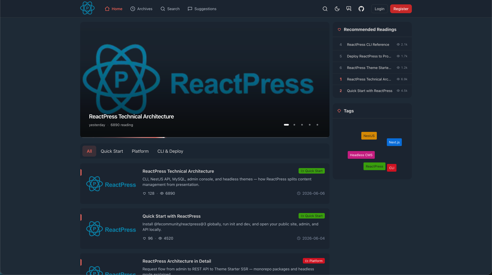
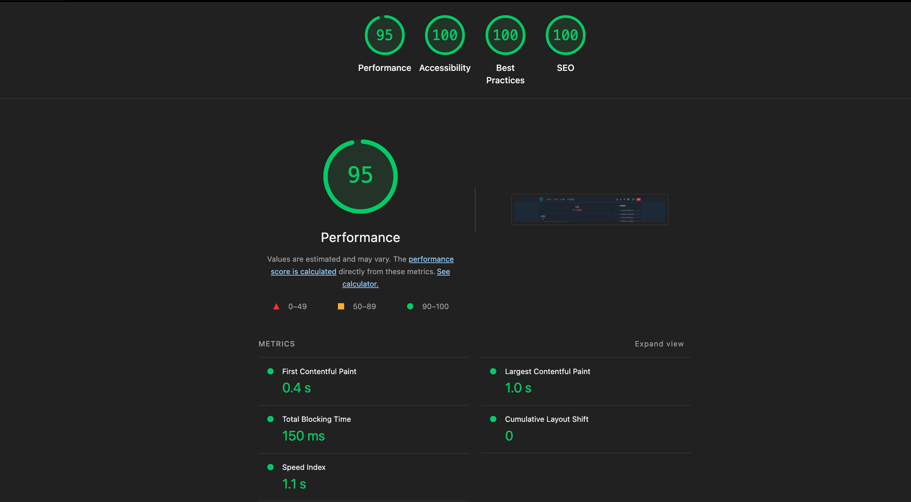

# ReactPress Theme Starter

<div align="center">

<a href="https://reactpress.cc/">
  
</a>

<br />

**专注访客站。CMS 交给 ReactPress。**

<br />

[ReactPress](https://github.com/reactpressjs/reactpress) 官方 Next.js 主题 —
负责路由、布局、SEO 与 UI。内容来自 Headless API，本仓库不内置 CMS。

<br />

<a href="https://reactpress-theme-starter.vercel.app">
  
</a>

<br />

[文档](https://reactpress.cc/) ·
[在线演示](https://reactpress-theme-starter.vercel.app) ·
[ReactPress](https://github.com/reactpressjs/reactpress) ·
[English](./README.md)

<br />


<a href="https://github.com/reactpressjs/reactpress-theme-starter/stargazers">
  
</a>

</div>

---

## 为什么选这个主题

面向 ReactPress 栈的生产级访客前端 — 不是又一个空壳 Next.js 博客模板。

|                    | 你能得到什么                                                                                                                            |
| :----------------- | :-------------------------------------------------------------------------------------------------------------------------------------- |
| **天然 Headless**  | 通过 [`@fecommunity/reactpress-toolkit`](https://www.npmjs.com/package/@fecommunity/reactpress-toolkit) REST 取数 — 内容留在 ReactPress |
| **无需后台可预览** | `pnpm dev:mock` — 内置示例数据，与 [在线演示](https://reactpress-theme-starter.vercel.app) 相同模式                                     |
| **开箱能力**       | 文章、归档、搜索、CMS 页面、知识库、评论、深浅色、RSS 与站点地图                                                                        |
| **后台驱动外观**   | 配色、Logo、导航在 ReactPress 控制台配置，配合 [`theme.json`](./theme.json)                                                             |
| **性能**           | Lighthouse **95 / 100 / 100 / 100** 开箱即用（见下）                                                                                    |

```text
ReactPress API  ──REST──▶  Theme Starter (Next.js)  ──▶  访客站
```

**技术栈：** Next.js 15 · React 19 · Tailwind CSS 4 · Node.js 22.23+ · pnpm 9

---

## 60 秒上手

无需安装 ReactPress — 用内置 Mock 数据预览主题。

### 方式 A — `create-next-app`（推荐）

```bash
npx create-next-app@latest reactpress-theme-starter \
  --example "https://github.com/reactpressjs/reactpress-theme-starter" \
  --use-pnpm
cd reactpress-theme-starter
pnpm dev:mock
```

### 方式 B — 手动克隆

```bash
git clone https://github.com/reactpressjs/reactpress-theme-starter.git
cd reactpress-theme-starter
pnpm install
pnpm dev:mock
```

打开 **http://localhost:3001**。

### 部署到 Vercel（零环境变量）

[`vercel.json`](./vercel.json) 使用 Mock 构建 — 一键部署，无需后台。

[](https://vercel.com/new/clone?repository-url=https%3A%2F%2Fgithub.com%2Freactpressjs%2Freactpress-theme-starter&project-name=reactpress-theme&repository-name=reactpress-theme&demo-title=ReactPress%20Theme%20Starter&demo-description=Next.js%2015%20headless%20blog%20theme%20with%20mock%20mode%20%E2%80%94%20no%20backend%20required&demo-url=https%3A%2F%2Freactpress-theme-starter.vercel.app&demo-image=https%3A%2F%2Fraw.githubusercontent.com%2Freactpressjs%2Freactpress-theme-starter%2Fmaster%2Fpublic%2Fhome-dark.png)

---

## 快速开始（完整栈）

**环境要求：** Node.js 22.23+、pnpm 9+

最快启动访客站 + 管理后台 + API 的方式是 [ReactPress CLI](https://reactpress.cc/)：

```bash
npm install -g @fecommunity/reactpress
mkdir my-site && cd my-site
reactpress init
```

| 入口 | 地址                         |
| :--- | :--------------------------- |
| 站点 | http://localhost:3001        |
| 后台 | http://localhost:3001/admin/ |
| API  | http://127.0.0.1:3002/api    |

默认账号：`admin` / `admin` — 上线前请修改。
卡住了？运行 `reactpress doctor`。

<div align="center">


</div>

### 对接真实 API 开发本主题

1. 克隆本仓库并执行 `pnpm install`。
2. 启动 API（`reactpress dev --api-only`，或指向已运行的完整栈）。
3. 如有需要，将 [`.env.example`](./.env.example) 复制为 `.env`（默认 API：`http://localhost:3002/api`）。
4. 在主题目录运行：

```bash
pnpm dev
```

打开 **http://localhost:3001** — 从 ReactPress API 加载真实内容。

开发时连接远程 API：

```bash
pnpm dev -- --remote-origin api.yoursite.com
```

---

## 性能表现

基于 Next.js 15 App Router，服务端渲染 + 静态生成 + 轻量客户端 — 开箱即用的 Core Web Vitals，无需额外调优。

<div align="center">



</div>

| 类别     | 得分    |
| :------- | :------ |
| 性能     | **95**  |
| 无障碍   | **100** |
| 最佳实践 | **100** |
| SEO      | **100** |

**Core Web Vitals**（[在线演示](https://reactpress-theme-starter.vercel.app) 首页）：

| 指标                           | 结果       |
| :----------------------------- | :--------- |
| First Contentful Paint (FCP)   | **0.4 s**  |
| Largest Contentful Paint (LCP) | **1.0 s**  |
| Total Blocking Time (TBT)      | **150 ms** |
| Cumulative Layout Shift (CLS)  | **0**      |
| Speed Index                    | **1.1 s**  |

---

## 常用命令

| 命令                 | 说明                                    |
| :------------------- | :-------------------------------------- |
| `pnpm dev`           | 主题 + 真实 ReactPress API              |
| `pnpm dev:mock`      | 主题 + 内置 Mock API（无需后台）        |
| `pnpm build:mock`    | Mock 数据生产构建（Vercel 演示 / 离线） |
| `pnpm build`         | 生产构建（构建时需能访问 API）          |
| `pnpm start`         | 生产服务，端口 **3001**                 |
| `pnpm run check`     | ESLint + Prettier                       |
| `pnpm run typecheck` | TypeScript 类型检查                     |

完整栈（站点 + 后台 + API）请优先使用 CLI 的 `reactpress init` / `reactpress dev`。

---

## 环境变量

使用 `pnpm dev` 对接真实 API 时，将 [`.env.example`](./.env.example) 复制为 `.env`。Mock 模式与 CLI 会处理大部分配置。

| 变量                             | 说明                                   |
| :------------------------------- | :------------------------------------- |
| `REACTPRESS_API_URL`             | 服务端 API 地址（须含 `/api`）         |
| `NEXT_PUBLIC_REACTPRESS_API_URL` | 浏览器端 API 地址；同域部署常用 `/api` |
| `CLIENT_SITE_URL`                | 站点公开 URL（SEO、Open Graph）        |
| `REACTPRESS_MOCK_API`            | 设为 `1` 启用内置 Mock API             |

更多可选项（子路径部署、GitHub OAuth、远程联调）见 `.env.example`。

---

## 部署

### 演示环境（Vercel）

直接 Import 本仓库即可 — [`vercel.json`](./vercel.json) 使用 `build:mock`。[在线演示](https://reactpress-theme-starter.vercel.app) 运行于 Mock 模式（仅界面 + 示例数据）。

### 生产环境

将 Headless 前端指向你的 ReactPress API：

1. 配置 `REACTPRESS_API_URL`、`NEXT_PUBLIC_REACTPRESS_API_URL`、`CLIENT_SITE_URL`
2. 使用 `pnpm build` 构建（不要用 `build:mock`）
3. 以 `pnpm start` 或平台 Next.js 运行时启动

`pnpm build` 会在构建阶段从 API 预取数据，请确保构建时可访问 API。

---

## 目录结构

```text
app/           App Router 页面、订阅源、站点地图、Mock API
components/    布局、文章、搜索、小部件
lib/           mock-api/、reactpress/ 工具
scripts/       开发、构建与冒烟测试脚本
theme.json     主题清单（路由、外观 Schema）
```

路由模板见 [`theme.json`](./theme.json)。外观在 ReactPress 管理后台配置。

---

## 常见问题

<details>
<summary><strong>预览主题一定要装 ReactPress 吗？</strong></summary>

不必。运行 `pnpm dev:mock` 即可用示例数据预览完整 UI。需要真实 CMS、后台与 API 时再安装 [ReactPress CLI](https://reactpress.cc/)。

</details>

<details>
<summary><strong>和 WordPress / Ghost 主题有什么不同？</strong></summary>

这是 **Headless 前端** — 内容在 ReactPress（REST API + 后台）。Next.js 主题单独部署并指向 API。详见 [ReactPress 文档](https://reactpress.cc/)。

</details>

<details>
<summary><strong>可以 Fork 或自定义组件吗？</strong></summary>

可以。MIT 许可。修改 `app/`、`components/`，或在 [`theme.json`](./theme.json) 声明路由。欢迎 PR — 见 [贡献指南](./CONTRIBUTING_zh.md)。

</details>

<details>
<summary><strong>Bug 去哪里提？</strong></summary>

主题 → [本仓库](https://github.com/reactpressjs/reactpress-theme-starter/issues)。核心（API、后台、CLI）→ [reactpressjs/reactpress](https://github.com/reactpressjs/reactpress/issues)。

</details>

---

## 生态

|                                                                          |                                   |
| :----------------------------------------------------------------------- | :-------------------------------- |
| [ReactPress](https://github.com/reactpressjs/reactpress)                 | CMS、后台、API、CLI、插件与桌面端 |
| [文档](https://reactpress.cc/)                                           | 指南、API 与架构                  |
| [Toolkit](https://www.npmjs.com/package/@fecommunity/reactpress-toolkit) | `@fecommunity/reactpress-toolkit` |
| [主题 Schema](./theme.manifest.schema.json)                              | 路由与外观清单                    |

---

## 参与贡献

欢迎 Issue 与 PR。见 [贡献指南（中文）](./CONTRIBUTING_zh.md) · [English](./CONTRIBUTING.md) · [行为准则](./CODE_OF_CONDUCT.md) · [安全策略](./SECURITY.md)。

## 许可证

[MIT](./LICENSE) © reactpressjs
