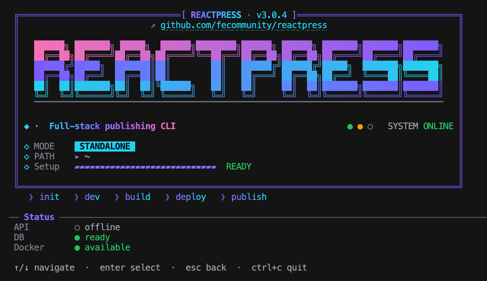

# ReactPress Theme Starter

<div align="center">

<a href="https://reactpress.cc/">
  
</a>

<br />

**专注访客站。CMS 交给 ReactPress。**

<br />

<a href="https://reactpress-theme-starter.vercel.app">
  
</a>

<br />

[文档](https://reactpress.cc/) ·
[在线演示](https://reactpress-theme-starter.vercel.app) ·
[ReactPress](https://github.com/reactpressjs/reactpress) ·
[English](./README.md)

<br />


<a href="https://github.com/reactpressjs/reactpress-theme-starter/stargazers">
  
</a>

</div>

---

[ReactPress](https://github.com/reactpressjs/reactpress) 官方访客站主题 —— 读者看到的博客、页面与知识库已就绪；你在 ReactPress 后台写内容、管站点。

---

## 为什么选它

- **开箱可发布** — 文章、归档、搜索、页面、知识库、评论一次齐备
- **品牌随你定义** — 配色、Logo、导航在 ReactPress 后台即可调整
- **深浅双色** — 白天夜晚都好读
- **更容易被发现** — RSS、站点地图、社交分享预览
- **先体验再投入** — 示例内容即可本地预览，不必先装 CMS
- **默认就快** — Lighthouse **95 / 100 / 100 / 100**

---

## 先看效果

[打开在线演示 →](https://reactpress-theme-starter.vercel.app)

或一键部署自己的演示站（示例内容，无需配置）：

[](https://vercel.com/new/clone?repository-url=https%3A%2F%2Fgithub.com%2Freactpressjs%2Freactpress-theme-starter&project-name=reactpress-theme&repository-name=reactpress-theme&demo-title=ReactPress%20Theme%20Starter&demo-description=Headless%20blog%20with%20mock%20mode%20%E2%80%94%20no%20backend%20required&demo-url=https%3A%2F%2Freactpress-theme-starter.vercel.app&demo-image=https%3A%2F%2Fraw.githubusercontent.com%2Freactpressjs%2Freactpress-theme-starter%2Fmaster%2Fpublic%2Fhome-dark.png)

---

## 本地试试（大约一分钟）

```bash
npx create-next-app@latest reactpress-theme-starter \
  --example "https://github.com/reactpressjs/reactpress-theme-starter" \
  --use-pnpm
cd reactpress-theme-starter
pnpm dev:mock
```

打开 **http://localhost:3001** — 自带示例文章，可以直接感受整体设计。

更习惯手动克隆？

```bash
git clone https://github.com/reactpressjs/reactpress-theme-starter.git
cd reactpress-theme-starter
pnpm install
pnpm dev:mock
```

---

## 运行完整产品

需要访客站 **加上** 管理后台与内容服务？安装一次即可：

```bash
npm install -g reactpressjs
mkdir my-site && cd my-site
reactpress init
```

| 你将打开     | 地址                         |
| :----------- | :--------------------------- |
| 你的站点     | http://localhost:3001        |
| 管理后台     | http://localhost:3001/admin/ |

默认账号：`admin` / `admin` — 上线前请修改。需要自检？运行 `reactpress doctor`。

更多说明见 [文档](https://reactpress.cc/)。

<div align="center">



</div>

---

## 性能表现

面向读者体验：首屏快、易读、利于搜索。

<div align="center">


</div>

| 类别     | 得分    |
| :------- | :------ |
| 性能     | **95**  |
| 无障碍   | **100** |
| 最佳实践 | **100** |
| SEO      | **100** |

---

## 常见问题

<details>
<summary><strong>只是想先看看，一定要装 ReactPress 吗？</strong></summary>

不必。用 `pnpm dev:mock` 或打开 [在线演示](https://reactpress-theme-starter.vercel.app) 即可。准备写真实内容、用后台时再安装：

```bash
npm install -g reactpressjs
```

</details>

<details>
<summary><strong>可以改外观和版式吗？</strong></summary>

可以。主题采用 MIT 许可 —— 自行改样式与页面结构，或保留默认布局，在 ReactPress 后台调整品牌色、Logo 与导航。

</details>

<details>
<summary><strong>从演示到正式上线怎么走？</strong></summary>

1. 安装并启动 ReactPress（`npm install -g reactpressjs` → `reactpress init`）
2. 让本主题连接你的真实内容
3. 部署访客站（例如 Vercel），CMS 按你托管 ReactPress 的方式运行

详细步骤见：[reactpress.cc](https://reactpress.cc/)。

</details>

<details>
<summary><strong>问题或反馈去哪里提？</strong></summary>

本主题 / 本仓库 → [GitHub Issues](https://github.com/reactpressjs/reactpress-theme-starter/issues)。  
ReactPress 产品（CMS、后台、CLI）→ [reactpressjs/reactpress](https://github.com/reactpressjs/reactpress/issues)。

</details>

---

## 了解更多

|                                                      |                                      |
| :--------------------------------------------------- | :----------------------------------- |
| [ReactPress](https://github.com/reactpressjs/reactpress) | CMS、后台、CLI、插件与桌面端       |
| [文档](https://reactpress.cc/)                       | 指南与产品说明                       |
| [`reactpressjs`（npm）](https://www.npmjs.com/package/reactpressjs) | `npm install -g reactpressjs` |

---

## 参与贡献

欢迎想法与 PR。见 [贡献指南（中文）](./CONTRIBUTING_zh.md) · [English](./CONTRIBUTING.md) · [行为准则](./CODE_OF_CONDUCT.md) · [安全策略](./SECURITY.md)。

## 许可证

[MIT](./LICENSE) © reactpressjs
